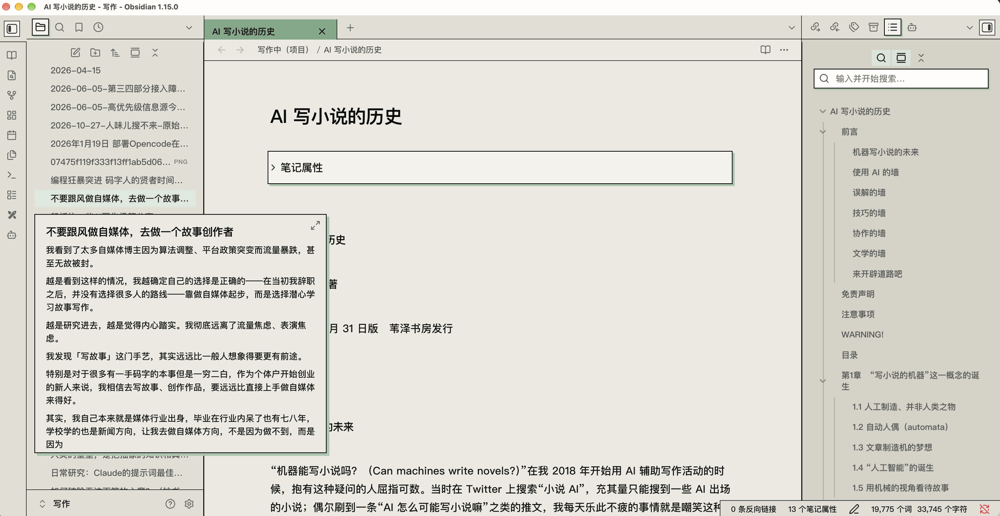
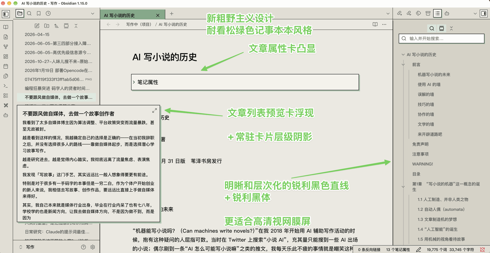

# chuanban-green（松绿记事本） — Botanical Editorial Neo-Brutalism Theme for Obsidian

**`chuanban-green`（松绿记事本）** is a Warm Editorial Neo-Brutalist theme for Obsidian, combining an exposed `1px` high-contrast grid, `0px` sharp corners, a 3-tier warm newsprint paper palette, heavy gothic typography paired with monospace tool zones, and soothing forest/sage green accents with hard-edge offset shadows.

---

## ✨ Key Features / 核心视觉特性

| 维度 | 设定值 | 视觉效果说明 |
| :--- | :--- | :--- |
| **全域纯直角 (`0px` Radius)** | `0px` | 彻底移除圆角与标签页底部 Chrome 圆弧脚，所有 Tab、按钮、输入框、弹窗均为干脆利落的直角矩形（开关与滑块保留 `1.5px~2px` 机械微倒角） |
| **外露网格线 (`Exposed 1px Grid`)** | `1px solid #181B18` | 铅字炭黑实线贯穿切分左右侧栏、Tab 栏、面包屑、大纲与表格，重现瑞士网格与复古 OS 秩序感 |
| **三阶印刷纸底 (`Warm Newsprint`)** | `#ECEAE2` / `#E2DFD5` / `#D6D2C6` | 中央道林浅灰纸 → 侧栏旧报刊中暖灰 → 右上大纲亚麻深暖灰，自然拉开分区景深 |
| **浓绿与淡绿双层强调色** | 竹青 `#78AB88` / 深松 `#26593F` | 顶部激活 Tab 采用竹青浓绿实心块 + 炭黑粗体字；文内双链采用 `2px` 深松浓绿粗实线底边 |
| **粗犷亮绿硬边阴影 (`Hard Shadow`)** | `3px 3px 0px #A3C9AE` | 零模糊纯色硬边偏移阴影，应用于 Claudian 提问盒、引用块、Callout、代码块、属性框与按钮 |
| **黑粗体 + 极客等宽混排** | 黑粗体 (`450`/`750~800`) + 等宽 (`Mono`) | 正文与标题采用高对比现代黑粗体；Claudian 状态行、Prompt 框、时间戳与表格数字采用等宽字体 |

### 📐 界面细节图解 (Visual Design Breakdown)

  

---

## 📦 Installation / 安装与使用

1. Open Obsidian -> **Settings -> Appearance -> Themes -> Manage**, search for **`chuanban-green`**（松绿记事本）, and click **Install and use**; or copy this folder into your vault's `.obsidian/themes/chuanban-green/` directory.
2. *(Optional)* With the **Style Settings** plugin installed, open **`chuanban-green (松绿记事本)`** to customize:
   - **Active Tab Style**: `Sage Bold (竹青浓绿底 + 炭黑粗体字)` ⇄ `Forest Dark (深松墨绿底 + 象牙米白字)`
   - **Body Typography Preset**: `Editorial Heavy Gothic (现代印刷黑粗体)` ⇄ `Typewriter Slab (更纱打字机体)` ⇄ `Classic Songti Serif (经典书卷宋体)`
   - **Hard Shadow Offset**: Default `3px`

---

## 📄 License

[MIT License](LICENSE) © 2026 chuanban ([Anarcadia](https://github.com/Anarcadia))
